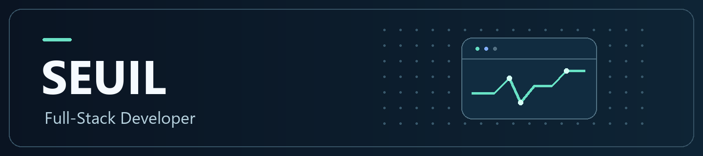

  

---

### Project · 프로젝트

  

---

### Connect · 연락하기

  <a href="mailto:sone91961@gmail.com">sone91961@gmail.com</a>
  &nbsp;·&nbsp;
  <a href="tel:+821024280919">010-2428-0919</a>

---

### Tech Stack · 기술 스택

**Frontend & Mobile**

**Backend**

**Database**

**DevOps**

